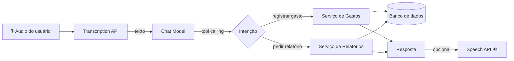

<div align="center">

# 💸 Budgeting

### Controle financeiro por voz com Spring AI

*Fale o que gastou. A IA entende, categoriza e registra para você.*


</div>

---

## 📖 Sobre o projeto

**Budget** é o processo de registrar os seus gastos pessoais para ter controle financeiro. O problema é que anotar cada gasto na mão é chato, e a gente acaba desistindo.

O **Budgeting** resolve isso com uma ideia simples: **você só precisa falar**.

> 🎙️ *"Gastei 50 reais no Starbucks."*
> 🎙️ *"Fui na padaria, o pão estava muito caro, comprei só 3 reais de pão."*
> 🎙️ *"Meu carro quebrou hoje, precisei ir no mecânico, gastei 300 reais no reparo."*

A aplicação recebe o áudio, transcreve, interpreta a intenção e persiste o gasto com **valor**, **local**, **descrição** e **categoria**. Depois, pela mesma API, você pode pedir relatórios em linguagem natural:

> 🎙️ *"Gostaria de um relatório de alimentação em outubro."*

---

## ✨ Funcionalidades

- 🎤 **Entrada por áudio**: registre gastos falando naturalmente
- 📝 **Transcrição automática** do áudio para texto
- 🧠 **Interpretação com LLM**: extrai valor, local, descrição e categoria da frase
- 🛠️ **Roteamento inteligente** via *tool calling*: a IA decide se a intenção é registrar um gasto ou gerar um relatório
- 💾 **Persistência** dos gastos em banco de dados
- 📊 **Relatórios por categoria e período**, interpretados e respondidos em linguagem natural
- 🔊 **Resposta em áudio** (opcional) com a Speech API

---

## 🏗️ Arquitetura



### Fluxo resumido

1. O usuário envia um áudio para a API.
2. A **Transcription API** converte o áudio em texto.
3. O **Chat Model** interpreta o texto e, via **Tool Calling**, escolhe qual serviço acionar.
4. O serviço executa a ação (registrar ou consultar) e persiste/lê do banco.
5. A resposta volta em texto e, opcionalmente, em áudio pela **Speech API**.

---

## 🤖 Ecossistema Spring AI

O projeto é uma forma prática de explorar as principais APIs do Spring AI:

| API | Papel no projeto |
|---|---|
| **Transcription API** | Converte o áudio do usuário em texto |
| **Chat Model** | Entende a frase e extrai os dados estruturados do gasto |
| **Tool Calling** | Permite que o modelo chame os serviços de registro e relatório |
| **Speech API** | Transforma a resposta em áudio (text-to-speech) |

---

## 🧰 Tecnologias

- **Java**
- **Spring Boot**
- **Spring AI**
- **Banco de dados:** *(a definir)*
- **Build:** Gradle ou Maven *(a definir)*

---

## 📂 Estrutura sugerida

```
budgeting/
├── src/main/java/.../budgeting/
│   ├── controller/     # Endpoints (upload de áudio, relatórios)
│   ├── service/        # Regras de negócio (gastos, relatórios)
│   ├── tools/          # Funções expostas ao modelo (tool calling)
│   ├── model/          # Entidades e DTOs (Expense, Category...)
│   └── repository/     # Acesso ao banco
├── src/main/resources/
│   └── application.properties
└── README.md
```

---

## 🚀 Como executar

> ⚠️ Ajuste os passos conforme a stack final do projeto.

### Pré-requisitos

- JDK 21+
- Chave de API do provedor de IA utilizado (ex.: OpenAI)
- Banco de dados configurado

### Passos

```bash
# 1. Clone o repositório
git clone https://github.com/JoaoGSantana10/budgeting.git
cd budgeting

# 2. Configure a chave da API como variável de ambiente
export OPENAI_API_KEY=sua-chave-aqui

# 3. Execute a aplicação
./gradlew bootRun
```

A API estará disponível em `http://localhost:8080`.

---

## 🔌 Endpoints (proposta)

| Método | Rota | Descrição |
|---|---|---|
| `POST` | `/api/audio` | Recebe um áudio e executa o fluxo completo (registrar gasto ou gerar relatório) |
| `GET` | `/api/expenses` | Lista os gastos registrados |
| `GET` | `/api/reports?category=&from=&to=` | Gera relatório por categoria e período |

### Exemplo de uso

```bash
curl -X POST http://localhost:8080/api/audio \
  -F "file=@gasto.mp3"
```

**Resposta esperada:**

```json
{
  "transcription": "Gastei 50 reais no Starbucks",
  "action": "REGISTER_EXPENSE",
  "expense": {
    "amount": 50.00,
    "place": "Starbucks",
    "description": "Café",
    "category": "Alimentação"
  }
}
```

---

## 🗺️ Roadmap

- [ ] Configurar projeto Spring Boot com Spring AI
- [ ] Integrar **Transcription API** (áudio → texto)
- [ ] Extrair dados do gasto com **Chat Model** (saída estruturada)
- [ ] Criar *tools* de registro de gasto e relatório (**Tool Calling**)
- [ ] Persistir gastos no banco de dados
- [ ] Gerar relatórios por categoria e data
- [ ] Responder em áudio com a **Speech API**
- [ ] Testes automatizados
- [ ] Documentação da API (OpenAPI/Swagger)

---

## 🎯 Objetivos de aprendizado

Este projeto também serve como laboratório para aprofundar, uma a uma, as APIs do ecossistema de IA do Spring: Transcription, Chat Model, Tool Calling e Speech.

---

## 👤 Autor

**João Guilherme Santana de Oliveira**

[](https://github.com/JoaoGSantana10)
[](https://linkedin.com/in/joão-guilherme-santana-de-oliveira-a73472416)

---

<div align="center">

Feito com ☕ e Spring AI

</div>
