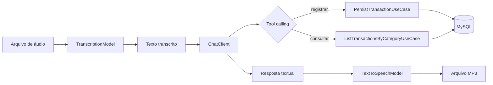

<div align="center">

# Budgeting

### Controle financeiro conversacional com Spring AI

Registre gastos por texto ou áudio, consulte transações por categoria e receba
respostas em áudio por meio das APIs da OpenAI integradas ao Spring Boot.


</div>

## Visão geral

O projeto demonstra como combinar:

- transcrição de áudio;
- chat com modelos OpenAI;
- tool calling;
- síntese de voz;
- persistência JPA;
- arquitetura em domínio, aplicação e infraestrutura.

Fluxo principal:



## Tecnologias

| Tecnologia | Uso |
|---|---|
| Java 25 | Linguagem principal |
| Spring Boot 4.2 | Aplicação, configuração e API REST |
| Spring AI 2.0.0-M4 | Chat, transcrição, speech e tools |
| OpenAI | Modelos configurados em `application.properties` |
| Spring Data JPA | Persistência de entidades |
| MySQL 9.6 | Banco de dados executado pelo Docker Compose |
| Lombok | Geração de getters e construtores |
| Gradle | Build e gerenciamento de dependências |

## Arquitetura

```text
dio.budgeting
├── application
│   ├── ListTransactionsByCategoryUseCase
│   ├── PersistTransactionUseCase
│   ├── input
│   └── output
├── domain
│   ├── Category
│   ├── Transaction
│   ├── TransactionId
│   └── TransactionRepository
└── infrastructure
    └── persistence
        ├── entity
        ├── http
        └── repository
```

O domínio representa as regras independentes do framework. Os casos de uso
coordenam as operações, enquanto a infraestrutura adapta JPA e HTTP ao restante
da aplicação.

## Como executar

### Pré-requisitos

- JDK 25;
- Docker com Docker Compose;
- chave da API OpenAI.

### 1. Configure a chave

Linux/macOS:

```bash
export OPENAI_API_KEY="sua-chave"
```

Windows PowerShell:

```powershell
$env:OPENAI_API_KEY="sua-chave"
```

### 2. Inicie o banco

```bash
docker compose up -d
```

O banco fica disponível em `localhost:3307`, com banco `transaction` e usuário
`app`. Os valores padrão estão definidos em `application.properties`.

### 3. Execute a aplicação

```bash
./gradlew bootRun
```

A aplicação inicia em `http://localhost:8080`.

## Endpoints

| Método | Rota | Descrição |
|---|---|---|
| `GET` | `/api/chat?prompt=...` | Envia texto ao ChatClient |
| `GET` | `/api/chat-model?prompt=...` | Envia texto diretamente ao modelo |
| `POST` | `/api/transcribe` | Transcreve um arquivo multipart |
| `POST` | `/api/sinthesize` | Converte texto em MP3 |
| `POST` | `/transactions` | Cadastra uma transação |
| `GET` | `/transactions/{category}` | Lista transações por categoria |
| `POST` | `/transactions/ai` | Executa o fluxo completo por áudio |

As categorias disponíveis são `GROCERIES`, `PHARMA` e `AUTO`.

### Cadastrar uma transação

```bash
curl -X POST http://localhost:8080/transactions \
  -H "Content-Type: application/json" \
  -d '{
    "description": "Compra no supermercado",
    "category": "GROCERIES",
    "amount": 5000
  }'
```

O valor é representado em centavos: `5000` corresponde a R$ 50,00.

### Consultar por categoria

```bash
curl http://localhost:8080/transactions/GROCERIES
```

### Transcrever um áudio

```bash
curl -X POST http://localhost:8080/api/transcribe \
  -F "file=@gravacao.m4a"
```

### Executar o fluxo completo por áudio

```bash
curl -X POST http://localhost:8080/transactions/ai \
  -F "file=@gravacao.m4a" \
  --output resposta.mp3
```

## Modelos configurados

As configurações ficam em `src/main/resources/application.properties`:

- Chat: `gpt-4o-mini`;
- Transcrição: `whisper-1`, português brasileiro;
- Voz: `gpt-4o-mini-tts`, voz `nova`, formato MP3;
- Tool calling: as operações disponíveis são registradas no `ChatClient`.

## Testes

Os testes de integração de OpenAI exigem `OPENAI_API_KEY`. Sem a variável, os
testes anotados com `@EnabledIfEnvironmentVariable` são desabilitados.

```bash
./gradlew test
```

## Documentação

Consulte a documentação detalhada em [`docs/README.md`](docs/README.md), com:

- explicação de cada classe;
- significado das principais anotações;
- fluxo de tool calling;
- arquitetura em camadas;
- exemplos de desenvolvimento.

## Autor

**João Guilherme Santana de Oliveira**

[](https://github.com/JoaoGSantana10)
[](https://linkedin.com/in/joão-guilherme-santana-de-oliveira-a73472416)
